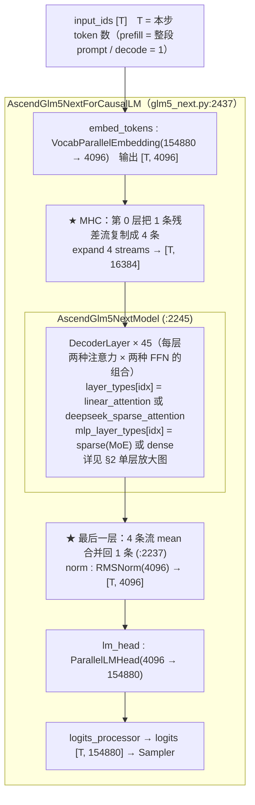
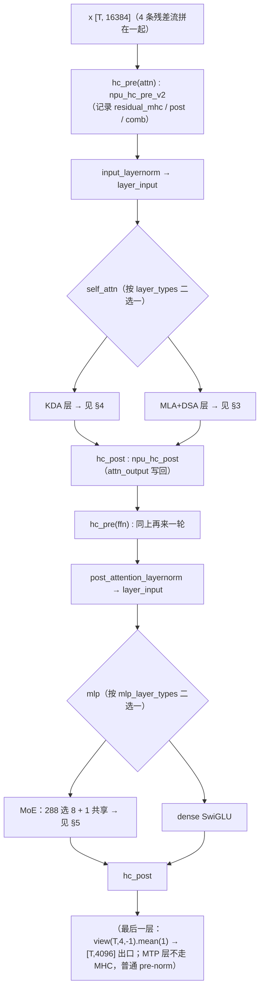
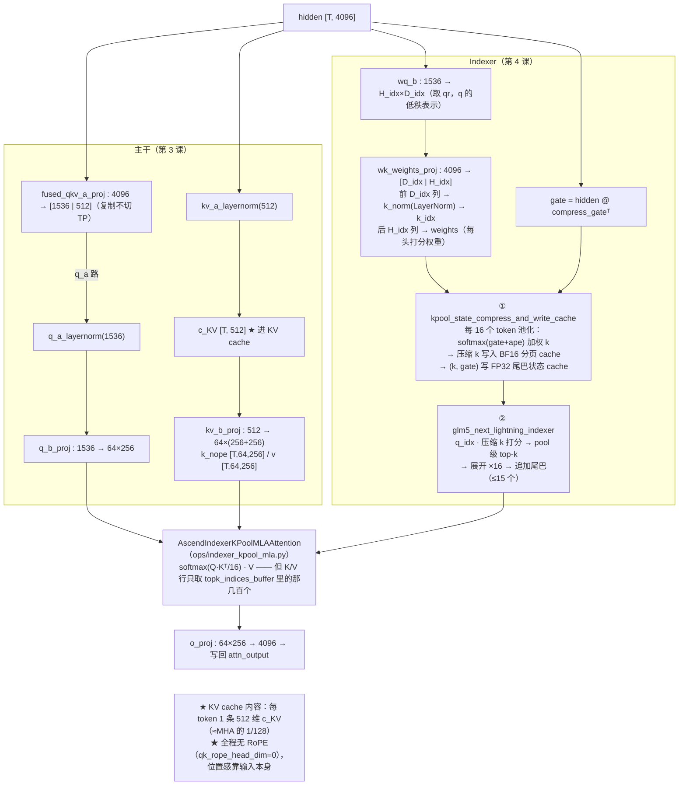
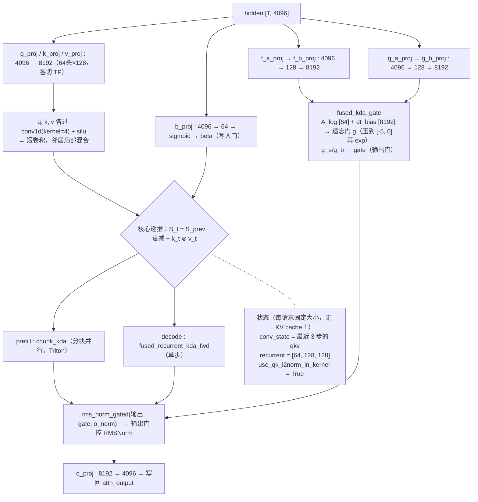
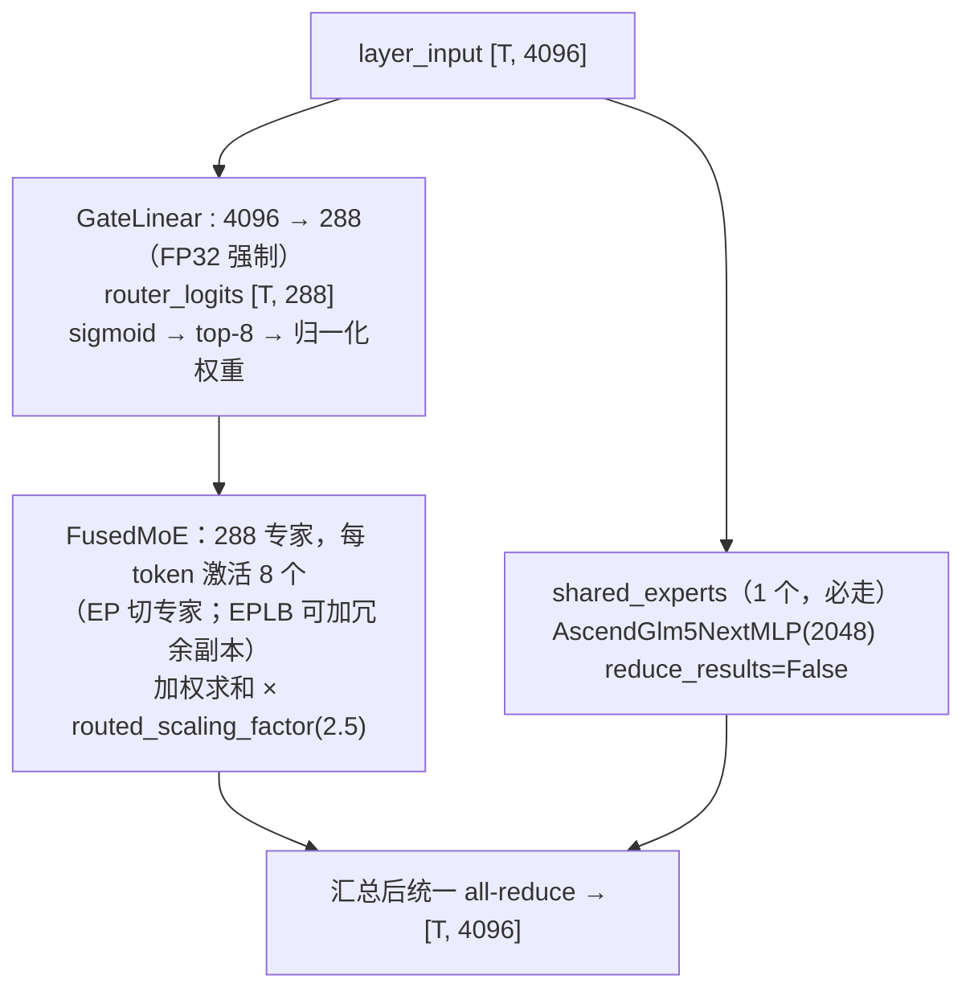
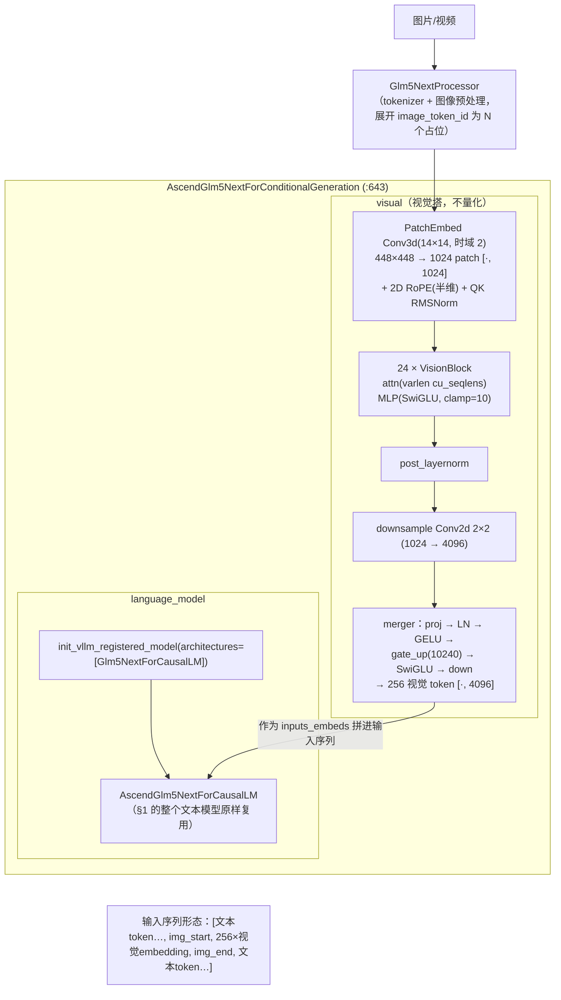
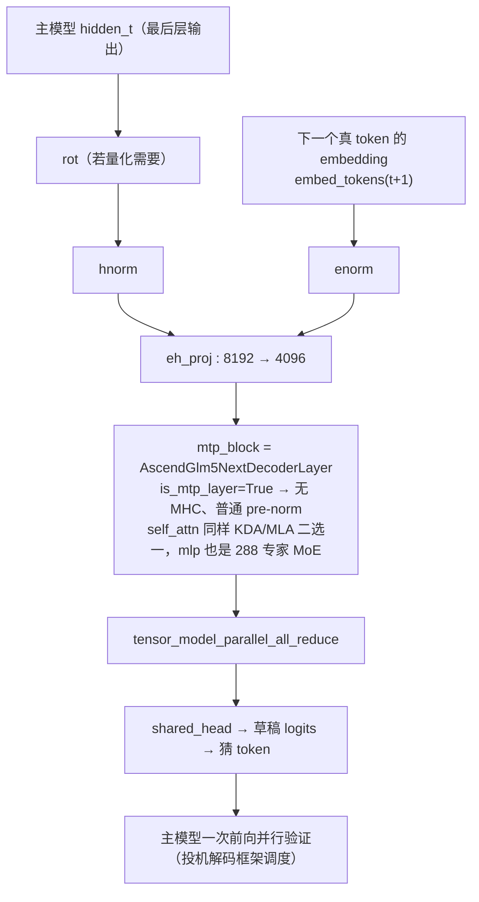

# 第 10 课（附图）：GLM5-Next 全模型结构图

> 配合第 1-9 课使用：先看 §1 总图建立全局，学到哪一课就回来看对应的放大图。
> 所有行号都指向 `vllm_ascend/models/glm5_next.py`（另有标注除外）。默认配置数字来自第 1 课。
> 每节附 Mermaid 版图（GitHub / VSCode 可直接渲染），供与上方 ASCII 原图对照。

---

## 1. 总图：一条 token 的完整旅程

```
 input_ids [T]                              T = 本步 token 数（prefill=整段prompt / decode=1）
     │
     ▼
╔══════════════════════════════════════════════════════════════════════╗
║  AscendGlm5NextForCausalLM  (glm5_next.py:2437)                      ║
║                                                                      ║
║   embed_tokens : VocabParallelEmbedding(154880 → 4096)   [T, 4096]   ║
║        │                                                             ║
║        ▼             ★ MHC：第0层把 1 条残差流复制成 4 条             ║
║   ┌─ expand 4 streams ──▶ [T, 16384] ──────────────────────┐         ║
║        │                                                             ║
║        ▼                                                             ║
║   AscendGlm5NextModel (:2245)                                        ║
║   ┌──────────────────────────────────────────────────────────┐       ║
║   │  DecoderLayer × 45   （每层两种注意力 × 两种 FFN 的组合）  │       ║
║   │                                                          │       ║
║   │   layer_types[idx]      = "linear_attention"             │       ║
║   │                           或 "deepseek_sparse_attention" │       ║
║   │   mlp_layer_types[idx]  = "sparse"(MoE) 或 "dense"       │       ║
║   │        │                                                 │       ║
║   │        ▼  详见 §2 单层放大图                              │       ║
║   └──────────────────────────────────────────────────────────┘       ║
║        │                                                             ║
║        ▼             ★ 最后一层：4 条流 mean 合并回 1 条 (:2237)      ║
║   norm : RMSNorm(4096)                                   [T, 4096]   ║
║        │                                                             ║
║        ▼                                                             ║
║   lm_head : ParallelLMHead(4096 → 154880)                            ║
║        │                                                             ║
║        ▼                                                             ║
║   logits_processor → logits [T, 154880] → Sampler                    ║
╚══════════════════════════════════════════════════════════════════════╝
```

**Mermaid 版：**



## 2. 单层放大：MHC 骨架 + 两种注意力 + 两种 FFN

每个 DecoderLayer（[:2053](../glm5_next.py#L2053)）都套在 MHC 骨架里；`self_attn` 和 `mlp` 按配置二选一：

```
 x [T, 16384]  （4 条残差流拼在一起）
     │
     ├─────────────── hc_pre(attn) : npu_hc_pre_v2 ──────────────┐
     ▼                        │                                    │
 input_layernorm → layer_input│                                    │
     │                        │ residual_mhc / post / comb         │
     ▼                        │                                    │
 ┌─────────────────────────────────────────────┐                   │
 │ self_attn（按 layer_types 二选一）           │                   │
 │   ├─ KDA 层       → 见 §4                    │  输出写入          │
 │   └─ MLA+DSA 层   → 见 §3                    │───attn_output────▶│
 └─────────────────────────────────────────────┘                   │
                              hc_post : npu_hc_post ◀──────────────┘
     │
     ▼  hidden [T, 16384]
     ├─────────────── hc_pre(ffn) : 同上再来一轮 ─────────────────┐
     ▼                                                            │
 post_attention_layernorm → layer_input                           │
     │                                                            │
     ▼                                                            │
 ┌─────────────────────────────────────────────┐                  │
 │ mlp（按 mlp_layer_types 二选一）             │                  │
 │   ├─ MoE 288选8+1共享 → 见 §5                │                  │
 │   └─ dense SwiGLU                            │                  │
 └─────────────────────────────────────────────┘                  │
                              hc_post ◀───────────────────────────┘
     │
     ▼
 （最后一层：view(T,4,-1).mean(1) → [T,4096] 出口；MTP 层不走 MHC，普通 pre-norm）
```

**Mermaid 版：**



## 3. 放大 A：MLA + DSA 层的 self_attn（第 3、4 课）

```
 hidden [T, 4096]
     │
     ├───────────────────────────────────────────────────────────────┐
     │                                                               │
     ▼ 主干（第3课）                                                  ▼ Indexer（第4课）
 fused_qkv_a_proj(4096 → [1536 | 512], 复制不切TP)        wq_b(1536 → H_idx×D_idx) ◀── 取qr
     │                    │                                        │   （q 的低秩表示）
     │ q_a路               │ kv_a路                                 ▼
     ▼                    ▼                              wk_weights_proj(4096 → [D_idx | H_idx])
 q_a_layernorm(1536)  kv_a_layernorm(512)                ├─ 前 D_idx 列 → k_norm(LayerNorm) → k_idx
     │                    │                              └─ 后 H_idx 列 → weights（每头打分权重）
     ▼                    ▼                                        │
 q_b_proj(1536→64×256)  c_KV [T,512] ★进KV cache                  │  gate = hidden @ compress_gateᵀ
     │                    │                                       ▼
     │                    └─ kv_b_proj(512 → 64×(256+256))    ① kpool_state_compress_and_write_cache
     │                          ├─ k_nope [T,64,256]          每16个token池化: softmax(gate+ape)加权k
     │                          └─ v     [T,64,256]           → 压缩k写入BF16分页cache
     │                                                        → (k,gate)写FP32尾巴状态cache
     │                                                        ② glm5_next_lightning_indexer
     │                                                           q_idx·压缩k 打分 → pool级top-k
     │                                                           → 展开×16 → 追加尾巴(≤15个)
     │                                                               │
     ▼                                                               ▼
 ┌───────────────────────────────────────────────────────────────────────┐
 │  AscendIndexerKPoolMLAAttention（ops/indexer_kpool_mla.py）           │
 │  softmax(Q·Kᵀ/16) · V —— 但 K/V 行只取 topk_indices_buffer 里的那几百个 │
 └───────────────────────────────────────────────────────────────────────┘
     │
     ▼
 o_proj(64×256 → 4096)   → 写回 attn_output

 ★ KV cache 内容：每 token 1 条 512 维 c_KV（≈MHA 的 1/128）
 ★ 全程无 RoPE（qk_rope_head_dim=0），位置感靠输入本身
```

**Mermaid 版：**



## 4. 放大 B：KDA 线性注意力层（第 5 课）

```
 hidden [T, 4096]
     │
     ├─ q_proj / k_proj / v_proj : 4096 → 8192 (64头×128)     各切 TP
     │        └─→ q,k,v 各过 conv1d(kernel=4) + silu   ← 短卷积，邻居局部混合
     ├─ b_proj  : 4096 → 64    → sigmoid → beta（写入门）
     ├─ f_a_proj→f_b_proj : 4096→128→8192  ┐
     ├─ A_log [64] + dt_bias [8192]        ├→ fused_kda_gate（遗忘门 g，压到[-5,0]再exp）
     └─ g_a_proj→g_b_proj : 4096→128→8192  → gate（输出门）
     │
     ▼
 ┌────────────────────────────────────────────────┐
 │ 核心递推  S_t = S_{t-1}·衰减 + k_t⊗v_t          │
 │   prefill : chunk_kda（分块并行, Triton）        │   状态（每请求固定大小）：
 │   decode  : fused_recurrent_kda_fwd（单步）      │   conv_state   = 最近3步的qkv
 │   use_qk_l2norm_in_kernel=True                  │   recurrent    = [64, 128, 128]
 └────────────────────────────────────────────────┘   （无 KV cache！）
     │
     ▼
 rms_norm_gated(输出, gate, o_norm)   ← 输出门控 RMSNorm
     │
     ▼
 o_proj(8192 → 4096)   → 写回 attn_output
```

**Mermaid 版：**



## 5. 放大 C：MoE FFN（第 6 课）

```
 layer_input [T, 4096]
     │
     ├──────────────────────────────────────────────┐
     ▼                                              ▼
 GateLinear(4096→288, FP32强制)              shared_experts（1个，必走）
     │  router_logits [T,288]                AscendGlm5NextMLP(2048)
     │  sigmoid → top-8 → 归一化权重               │ reduce_results=False
     ▼                                              │
 FusedMoE：288专家，每token激活8个                    │
   （EP切专家；EPLB可加冗余副本）                     │
     │  加权求和 × routed_scaling_factor(2.5)         │
     └──────────────────────┬───────────────────────-┘
                            ▼
              汇总后统一 all-reduce → [T, 4096]
```

**Mermaid 版：**



## 6. 放大 D：多模态侧（第 7 课，glm5_next_multimodal.py）

```
 图片/视频
     │ Glm5NextProcessor（tokenizer + 图像预处理，展开 image_token_id 为 N 个占位）
     ▼
╔════════════════════════════════════════════════════════════╗
║ AscendGlm5NextForConditionalGeneration (:643)              ║
║                                                            ║
║  visual（视觉塔, 不量化）                    language_model ║
║  ┌──────────────────────────────────┐      ║
║  │ PatchEmbed Conv3d(14×14, 时域2)   │      ║
║  │   448×448 → 1024 patch [·,1024]  │      ║
║  │        + 2D RoPE(半维) + QK RMSNorm      │   init_vllm_registered_model(
║  │ 24 × VisionBlock(                 │      ║     architectures=["Glm5NextForCausalLM"])
║  │     attn(varlen cu_seqlens)       │      ║        │
║  │     MLP(SwiGLU, clamp=10))        │      ║        ▼
║  │ post_layernorm                    │      ║   AscendGlm5NextForCausalLM
║  │ ├ downsample Conv2d 2×2(1024→4096)│      ║   （§1 的整个文本模型原样复用）
║  │ └ merger: proj→LN→GELU→           │      ║
║  │    gate_up(10240)→SwiGLU→down     │      ║
║  │   → 256 视觉 token [·, 4096]      │      ║
║  └──────────────────────────────────┘      ║
║         │ 作为 inputs_embeds 拼进输入序列    ║
║         └──────────────────────────────────▶║
╚════════════════════════════════════════════════════════════╝
 输入序列形态: [文本token…, img_start, 256×视觉embedding, img_end, 文本token…]
```

**Mermaid 版：**



## 7. 放大 E：MTP 草稿层（第 8 课，glm5_next_mtp.py）

```
 主模型 hidden_t（最后层输出）        下一个真 token 的 embedding
        │                                  │
        ▼                                  ▼
   (rot 若量化需要)                    embed_tokens(t+1)
        │                                  │
        ▼                                  ▼
     hnorm                              enorm
        └────────────┬─────────────────────┘
                     ▼
              eh_proj(8192 → 4096)
                     ▼
        mtp_block = AscendGlm5NextDecoderLayer
        （is_mtp_layer=True → 无 MHC、普通 pre-norm；
          self_attn 同样 KDA/MLA 二选一，mlp 也是 288 专家 MoE）
                     ▼
        tensor_model_parallel_all_reduce
                     ▼
        shared_head → 草稿 logits → 猜 token
                     ▼
        主模型一次前向并行验证（投机解码框架调度）
```

**Mermaid 版：**



## 8. 三个 cache 的家底（显存规划速查）

| cache | 内容 | 精度 | 增长方式 | 所属层 |
|---|---|---|---|---|
| MLA 主 KV cache | c_KV 512 维/每token | 模型 dtype | 随序列长度线性 | DSA 层 |
| Indexer K cache | 压缩 k（每 16 token 1 条 D_idx 维） | BF16 | 每 16 token 增 1 | DSA 层 |
| Compressor 状态 | 尾巴 (k, gate)，每 token 2×D_idx | FP32 | 滑动窗口 16 | DSA 层 |
| KDA conv + recurrent | 3 步 qkv + [64,128,128] | 按 mamba dtype | **固定，与长度无关** | KDA 层 |

45 层全部 MoE + 混合注意力：**长上下文显存 = DSA 层数 × 512/词 × 长度 + KDA 层数 × 常数**，这就是 1M 上下文的底气。

## 9. 用图导航源码

| 想看懂… | 去哪 | 对应课文 |
|---|---|---|
| §1 总图 | [`glm5_next.py:2437, 2245`](../glm5_next.py#L2437) | 第 2 课 |
| §2 MHC | [`:148, 2147-2241`](../glm5_next.py#L148) | 第 2 课 |
| §3 MLA/DSA | [`:1881-2052, 261-1402`](../glm5_next.py#L1881-L2052) | 第 3、4 课 |
| §4 KDA | [`:1541-1880`](../glm5_next.py#L1541-L1880) | 第 5 课 |
| §5 MoE | [`:1403-1539`](../glm5_next.py#L1403-L1539) | 第 6 课 |
| §6 多模态 | [`glm5_next_multimodal.py:250-706`](../glm5_next_multimodal.py#L250-L706) | 第 7 课 |
| §7 MTP | [`glm5_next_mtp.py:39-243`](../glm5_next_mtp.py#L39-L243) | 第 8 课 |
| 配置真相 | `transformers_utils/configs/glm5_next.py` | 第 1 课 |
